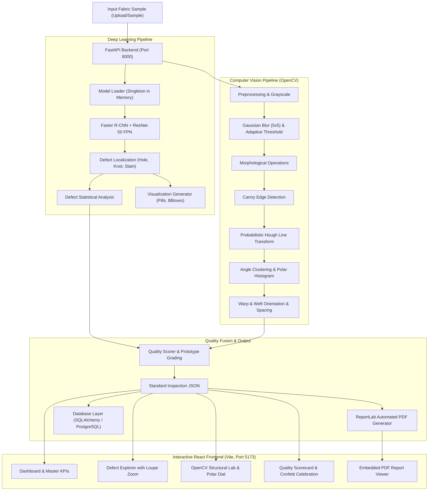

# Technical Architecture Design

## "AI-Powered Fabric Structure Analysis, Defect Detection and Quality Inspection System"

---

## 1. System Architecture Overview

---

## 2. Component Design Specifications

### A. Model Loader & Defect Detector (`backend/app/model/`)
- **Weights Location**: Outside repository at `E:\Project\models\object detection\best_model.pth` (~473 MB).
- **Architecture**: `fasterrcnn_resnet50_fpn` with torchvision default anchor sizes and aspect ratios.
- **Classification Head**: `FastRCNNPredictor` configured with `num_classes = 4` (`0: background`, `1: hole`, `2: knot`, `3: stain`).
- **Singleton Pattern**: Loaded once during FastAPI application lifespan on server startup; cached in memory.
- **Inference Mode**: Executed inside `torch.inference_mode()` with tensor conversion to `(C, H, W)` normalized `[0, 1]`.

### B. Defect Statistical Analysis (`backend/app/analysis/defect_analysis.py`)
- Calculates:
  - Total defect count & per-class frequency
  - Defect density per 100,000 pixels and per megapixel
  - Bounding box areas (min, max, mean, std)
  - Fabric area percentage affected
  - Defect severity breakdown (Critical, Moderate, Minor)
- Strict boundary: Runtime inspection measurements are completely segregated from benchmark model validation metrics (mAP@50, F1).

### C. OpenCV Structural & Warp/Weft Engine (`backend/app/analysis/structure_analyzer.py`)
1. **Grayscale Normalization**: Converts RGB to single-channel 8-bit intensity map.
2. **Noise Reduction**: $5 \times 5$ Gaussian kernel ($\sigma = 1.2$) suppresses random sensor noise while preserving yarn edges.
3. **Adaptive Thresholding**: Generates binary high-contrast masks under uneven textile lighting.
4. **Morphological Filtering**: Rectangular structuring element bridges micro-gaps in thread paths.
5. **Canny Edge Detection**: Auto-calculated dual thresholds based on median image intensity:
   $$\text{lower} = \max(20, 0.66 \times \text{median}), \quad \text{upper} = \min(240, 1.33 \times \text{median})$$
6. **Probabilistic Hough Line Transform**: Detects line segments $(x_1, y_1, x_2, y_2)$ satisfying minimum thread length and maximum line gap constraints.
7. **Orientation Angle Clustering**: Computes line angle $\theta = \arctan2(\Delta y, \Delta x) \pmod{180^\circ}$, clustering into two orthogonal modes:
   - Warp mode: $45^\circ \le \theta \le 135^\circ$
   - Weft mode: $0^\circ \le \theta < 45^\circ$ or $135^\circ < \theta < 180^\circ$
8. **Inter-Yarn Spacing Estimation**: Projects thread intercepts across orthogonal cross-sections to compute mean spacing and standard deviation.

### D. Quality Scoring & Prototype Grading (`backend/app/analysis/quality_scorer.py`)
$$\text{quality\_score} = (0.60 \times \text{defect\_score}) + (0.40 \times \text{structure\_score})$$

- **Defect Score**: Starts at 100, penalized by:
  - Per-defect penalty (Hole: 15 pts, Knot: 7.5 pts, Stain: 6 pts)
  - Area percentage penalty ($\min(40, \text{defect\_area\_pct} \times 15)$)
  - Spatial density penalty ($\min(15, \text{density} \times 4)$)
- **Structure Score**: Starts at 100, penalized by:
  - Angular orthogonality deviation: $\Delta \theta = | |\theta_{\text{warp}} - \theta_{\text{weft}}| - 90^\circ |$
  - Coefficient of variation of thread spacing ($CV = \sigma / \mu$)
- **Grading Scale**:
  - Grade A: $90 \le \text{Score} \le 100$
  - Grade B: $75 \le \text{Score} < 90$
  - Grade C: $60 \le \text{Score} < 75$
  - Grade D: $\text{Score} < 60$

### E. Database Layer (`backend/app/database/`)
- Uses SQLAlchemy ORM with dual-engine support (SQLite local default, PostgreSQL configurable).
- Stores all numerical results, defect counts, quality scores, grades, and paths to original, annotated, and PDF files.
- The 500 MB model checkpoint is strictly excluded from database storage.

### F. Frontend Architecture (`frontend/src/`)
- Built on **React 19 + Vite 8** with bespoke textile-inspired dark styling:
  - **WeaveBackground**: HTML5 canvas simulating organic textile threads that undulate in the background.
  - **Loom Laser Scanner**: Real-time sweeping laser beam animation while AI processes uploaded fabrics.
  - **Defect Explorer**: Interactive bounding box filter pills and side-by-side original/annotated view.
  - **OpenCV Structural Lab**: Visual step-by-step pipeline carousel and SVG polar orientation compass.
  - **Quality Scorecard**: Animated circular score meter with confetti celebration for high grades.
  - **ReportModal**: Embedded in-app PDF report viewer with direct download and print triggers.
